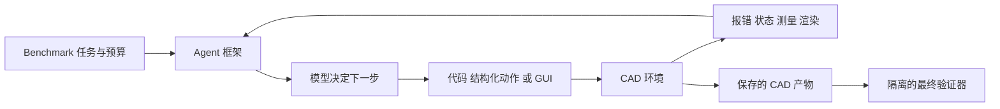
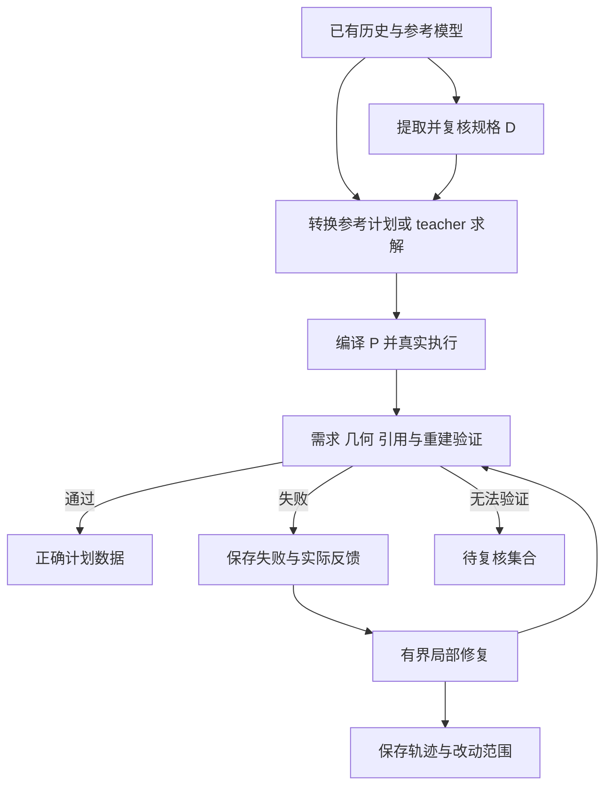

# CAD Benchmark Agent 与模型调研报告

> 历史调研快照：正文保留 2026-10-22 的调查状态与公开成绩，不代表当前发布状态。2026-10-27–28 已跑通 CADDesigner，并完成 CADTestBench 与 BenchCAD 开发样例实验；更新结论、费用与证据请看[阶段汇总](../reports/2026-10-28-CAD.md)。本文当时“未运行/未确认”的描述按历史时点理解。

调研日期：2026 年 10 月 22 日。重点：参数化机械 CAD、程序化建模、交互式 Agent，以及对本项目训练数据构建的启发。

本报告基于官方论文、作者仓库、模型卡和 benchmark 网站。公开成绩均为作者或维护者报告，未在本地复跑。仓库可访问、权重页面存在、完整训练可复现是不同状态，下文分别说明。不覆盖全部建筑 BIM、二维制图、仿真设计优化或通用 mesh 生成工作。

## 1 主要结论

1. **CAD benchmark 已从单次序列生成扩展到可执行程序、交互修复、装配和 GUI 工作流。** 应先选择任务和操作接口，再比较成绩；图像重建、文本建模与 GUI 操作测到的能力不同。
2. **现阶段建议优先程序化路线。** Parametric CAD Bench V3 已有 Harbor 入口；CADTestBench 提供按需求写几何测试的路径；RealCADBench 补充工业设计意图和装配任务，三者分别对应执行框架、验收和任务真实性。
3. **Agent 与模型必须分开。** Codex、CADDesigner、CAD-Assistant 是组织工具和执行循环的系统；CADFusion、CAD-Recode 是特定输入输出形式的模型。RA-CAD、ToolCAD、IterCAD、DeciCAD 同时研究交互框架和策略训练，横跨两层。
4. **类型化计划 P 有工程价值，但不是天然的新颖贡献。** ReliCAD 已研究规格、内核执行和反馈修复；ToolCAD、DeciCAD 已研究专用动作接口与训练。需要证明本项目的数据、接口或局部修复方法带来额外收益。
5. **先构建可验证 instance，再采集轨迹，最后微调。** 如果 verifier 不能区分合法几何与满足需求的几何，扩大生成只会扩大标签噪声。

以上为综合判断，各项工作的事实依据见后文。

## 2 三个层面如何对应

| 层面 | 回答的问题 | CAD 中的具体内容 | SWE 类比 |
|---|---|---|---|
| Benchmark / instance | 做什么，怎么验收 | 输入、初始工程文件、环境、允许工具、验证器和预算 | issue、仓库快照、测试与执行约束 |
| Agent / harness | 如何组织解题 | 提示词、状态管理、工具调用、执行、反馈、重试和停止策略 | Codex / Claude Code / 自建 runner |
| 模型 / policy | 根据上下文决定下一步 | 输出代码、计划、工具调用或 GUI 动作的权重 | coding LLM / VLM |

Docker 是环境封装方式，GUI 是交互方式，SDK 是程序接口；它们不是互斥选项。Docker 中可以运行 headless CAD，也可以配桌面。FreeCAD 既能通过 Python API 使用，也能通过界面使用。

### 2.1 四种解题形式

| 形式 | 模型主要输出 | 反馈 | 主要适用问题 |
|---|---|---|---|
| 单次序列生成 | sketch / extrude 等参数序列 | 通常执行后统一评测 | 几何表示、序列预测 |
| 程序化 Agent | CadQuery、FreeCAD API、build123d 代码 | 报错、测量、渲染 | coding Agent 建模与修复 |
| CAD 专用工具 Agent | 有类型的 CAD 动作、对象引用与参数 | 对象状态、约束、内核错误 | 控制动作空间、学习规划 |
| GUI Agent | 点击、输入、拖拽、快捷键 | 截图和应用响应 | 真实软件操作、长流程和界面定位 |

图像作为输入、渲染作为反馈，都不意味着使用 GUI。判断应看 Agent 如何修改 CAD 状态。

## 3 Benchmark 层面

### 3.1 重点 benchmark 对照

| 名称与版本 | 规模与任务 | 主要解题接口 | 验收重点 | 对本项目的用途 |
|---|---|---|---|---|
| [Parametric CAD Bench V3](https://cadbench.ai/news/cad-bench-v3)，2026.09.21 | 100 题：30 文本创建、30 创建后编辑、40 工程图创建 | 终端 coding Agent 与 FreeCAD 环境 | 自动几何评分、规格及参考 CAD 一致性 | Harbor instance、运行协议与隔离 |
| [CADTestBench](https://arxiv.org/abs/2605.07807v1)，2026.05 | 200 个 CAD 程序来源，每个有抽象与详细描述 | 程序化生成；CadQuery 查询几何 | 按 prompt 执行几何和拓扑 CADTests | verifier 与需求到测试的绑定 |
| [RealCADBench v2](https://arxiv.org/abs/2609.03773v2)，2026.09 | 总计 12,632 个任务；论文评测切片 1,770 题，其中装配 25 题 | FreeCAD API Python | 可执行性、Solid IoU、Surface IoU、视觉语义 Judge | 工业任务、不同输入与装配泛化 |
| [BenchCAD 2.0](https://benchcad.com/blog/benchcad-2.html)，2026.10.12 | Core 为 100 个保留案例，六类任务 | 程序化工程建模；含图纸、渲染、装配及 ECAD | 与参考答案比较，任务分别计分，不使用 LLM judge | 复杂工程图和装配空间推理 |
| [CADWorld v2](https://arxiv.org/abs/2609.16251v2)，2026.09 | 200 题、11 类工作流 | 截图与 GUI 动作操作 FreeCAD | 保存产物的几何、约束、参数结构与工程状态 | GUI Agent 独立方向 |
| [Text2CAD-Bench](https://arxiv.org/abs/2605.18430v1)，2026.05 | 600 个人工整理样本、四级难度，每题两种描述 | 文本到参数化 CAD | 不同几何难度和领域的生成表现 | 题目难度和描述粒度 |
| [CADBench v2](https://arxiv.org/abs/2605.10873v2)，2026.06 更新 | 18,000 个评测样本、五种输入模态、六个数据家族 | 图像 / mesh 到 CAD 程序 | 几何保真、可执行性、程序紧凑性等 | 多模态重建；与 D→P 不完全同题 |
| [HistCAD v4](https://arxiv.org/abs/2602.19171v4)，2026.10.08 更新 | 两个集合共 180,495 条历史；不是测试题数 | 给定移除草图显式约束的历史，预测约束 | 初始重建、尺寸编辑、关系保持与全历史重建 | 对象引用、可编辑性验收 |
| [IterCAD-Bench / IterCAD v3](https://arxiv.org/abs/2606.13368v3)，2026.08 更新 | 工程图生成、文本生成、交互编辑 | 多轮 CAD 代码执行 sandbox | CD-TR 与 AUC-TR 联合反映可执行性和几何精度 | 修复轨迹与多轮评测 |
| [CADGenBench](https://github.com/huggingface/cadgenbench)，当前仓库快照 | CAD 生成与编辑；不固定动态样本数 | 提交 STEP；参考 Agent 用 build123d | 合法性、形状、接口区域、拓扑 | 局部装配接口和多维验收 |

规模有不同口径：历史总量、原始任务池、正式评测切片和 prompt 变体不能直接相加，也不是同一种 instance 数量。

### 3.2 现成可运行性与 Harbor 状态

| 项目 | 已确认公开入口 | Harbor 状态 | 落地条件与边界 |
|---|---|---|---|
| Parametric CAD Bench V3 | [Harbor Hub](https://hub.harborframework.com/datasets/gnucleus-ai/cad-bench/latest)、[validator](https://github.com/gNucleus-AI/freecad-validator)、[提交仓库](https://github.com/gNucleus-AI/cad-bench-submission) | **已确认**，schema 1.3；Hub 标注 harbor ≥ 0.20.0 | 官方 V3 协议固定 Harbor 0.23.0、FreeCAD 1.1.0；复现须锁版本和 dataset digest |
| CADTestBench | [代码](https://github.com/dimitrismallis/CADTestBench)、[数据](https://huggingface.co/datasets/dimitrismallis/CADTestBench) | 未确认现成 Harbor 包 | 有评测入口和 baseline 输出约定，需适配 Agent runner |
| CADWorld | [代码](https://github.com/Zdong104/CADWORLD)、项目页数据入口 | 官方以 VM runner 为主；未确认 Harbor 包 | Linux/KVM、Docker、FreeCAD VM；README 要求约 35 GB 空间用于 VM 镜像 |
| BenchCAD | [网站与代码入口](https://benchcad.com/) | 未确认 | 1.0 代码与数据有公开许可；2.0 Core 通过 evaluation-only 协议提供 |
| CADGenBench | [代码与提交说明](https://github.com/huggingface/cadgenbench) | 未确认 | 提交 STEP，在 Space 对私有参考评分；包含迭代 baseline |
| 其余表内工作 | 固定版本论文及其中项目入口 | 未确认 | 论文存在不等于任务资产、环境和参考解全部可获取 |

“未确认”表示未建立现成 Harbor 发布的证据，不表示一定不存在。上表可运行性来自公开说明，本次没有安装与 smoke test。公开测试题也不自动具备训练和重新分发许可。

### 3.3 优先看哪些

**第一优先：Parametric CAD Bench V3。** 有 Harbor、通用 coding Agent 记录和确定性评分。V3 改了任务分布、评分和隔离，不能用 V1/V2 成绩描述 V3。维护者报告曾观察到 V2 轨迹寻找隐藏参考或 grader，因此 V3 将参考几何保留在独立 verifier 并限制网络。最值得借鉴的是任务与答案隔离，而不只是 Dockerfile。[V3 协议](https://cadbench.ai/news/cad-bench-v3)

**第一优先：CADTestBench。** 同一个文本可能对应多个正确几何。它按需求执行测试，避免只与一个标准模型比较；测试经过 mutation analysis 检查区分错误的能力。适合验收“孔径对但未贯穿”“外形接近但结构错”。[论文](https://arxiv.org/html/2605.07807v1)、[代码](https://github.com/dimitrismallis/CADTestBench)

**第二优先：RealCADBench。** 按工业文本、工程图、实物图、渲染区分输入，并覆盖零件和装配。装配 Agent 实验只覆盖 25 题，不能扩成全部 12,632 题结论。语义 Judge 可以补充身份和细节判断，但不宜单独作为正确训练标签。[论文](https://arxiv.org/abs/2609.03773v2)

**条件优先：BenchCAD 2.0 和 CADWorld。** 前者适合复杂图纸和装配，有数据访问条件；后者适合 GUI，交互成本和错误来源不同，不宜成为当前 T2 项目第一阶段的必做项。[BenchCAD 2.0](https://benchcad.com/blog/benchcad-2.html)、[CADWorld](https://arxiv.org/abs/2609.16251v2)

### 3.4 传统数据集的位置

| 数据或工作 | 提供什么 | 不能直接等同于什么 |
|---|---|---|
| [DeepCAD](https://arxiv.org/abs/2105.09492v2) | 178,238 个模型及构造序列，许多后续工作的来源 | 完整自然语言 Agent 任务集 |
| [Fusion 360 Gallery](https://github.com/AutodeskAILab/Fusion360GalleryDataset) | CAD 数据、工具、文档，可作为几何和历史来源 | 已验证的本项目 D→P 标签；应区分子集与许可 |
| [Text2CAD](https://arxiv.org/abs/2409.17106v1) | DeepCAD 基础上的约 170K 模型、660K 多粒度文本标注 | 2026 年 Text2CAD-Bench，也不是现成 GUI 环境 |

源历史可以用于构造参考解，但仍须做 API 转换、执行和需求验证。数据划分应按源模型家族和来源分组，避免同一模型的不同描述同时进入训练与测试。

## 4 Agent 层面

### 4.1 代表系统

| Agent / 系统 | 交互与反馈 | 训练 | 公开与复用状态 | 对本项目的参考 |
|---|---|---|---|---|
| [CADDesigner v6](https://arxiv.org/html/2508.01031v6)，2026.05 更新 | 通用 Agent、ECIP 显式上下文、CAD 代码、视觉迭代、案例知识库 | 重点是工具与架构 | 已核实论文，未建立完整官方可复现仓库证据 | 对象与上下文、LLM 友好接口 |
| [CAD-Assistant](https://github.com/dimitrismallis/CAD-Assistant)，ICCV 2025 | VLLM 规划、Python 解释器、FreeCAD API、渲染与专用工具 | training-free 框架 | 官方实现公开，含 FreeCAD 集成 | 工具增强 solver 的实现 |
| [ReliCAD v1](https://arxiv.org/html/2609.22325v1)，2026.09 | 意图规格、Agent-ready API、内核证据、验证修复 | 主要贡献是可靠执行架构 | 论文已核实，代码与数据权限待核实 | 与 D→计划→执行→验证直接相关 |
| [ToolCAD v2](https://arxiv.org/abs/2604.07960v2)，2026.04 | modeling gym、工具轨迹、混合反馈 | 在线课程 RL | 论文已核实，完整发布状态待核实 | 交互动作策略训练 |
| [RA-CAD v4](https://arxiv.org/html/2608.05714v4)，2026.10 更新 | Generate→Execute→Critique→Rewrite | SFT 后轨迹级 GRPO，联合优化代码和 critique | 论文已核实，完整训练产物未确认 | 从执行反馈学习有效修正 |
| [IterCAD v3](https://arxiv.org/abs/2606.13368v3)，2026.08 更新 | 图纸/文本到代码、多轮执行、交互编辑 | progressive SFT 与几何 RL | 论文已核实，完整资产待核实 | 数据合成、编辑轨迹、失败纳入指标 |
| [DeciCAD v1](https://arxiv.org/abs/2610.21755v1)，2026.10.15 | CAD 语义动作、决策观察、持久状态与反馈 | 轨迹监督、SFT 与几何在线 RL | 新预印本，未验证发布资产 | P 接口与策略学习的直接对照 |
| Codex、Claude Code、mini-swe-agent | 写程序、运行、根据反馈修改；可配置图像工具 | 可用通用模型作为 solver | CAD Bench V3 已有公开组合成绩 | 先建立强通用基线 |

通用 coding Agent 的 CAD 实践证据来自 [Parametric CAD Bench V3 榜单](https://cadbench.ai/leaderboard)。它说明特定配置运行过 CAD 任务，不证明任意默认安装具备相同工具和成功率。

### 4.2 CADWorld 实际使用什么 Agent

CADWorld 主要实验使用作者自建 runner：任务与截图送入模型，模型输出 GUI 动作，runner 执行并继续截图。七个模型为 GPT-5.4、Claude Opus 4.8、Kimi K2.6、MiniMax M3、Holo 3.1、Qwen3.6、OpenCUA。前两者使用 provider 原生 computer tool，其余经动作适配。这个设置并非直接运行 Codex 或 Claude Code。[附录 D 与 L](https://arxiv.org/html/2609.16251v2)

它采用共同 GUI 环境，但适配器、坐标处理、原生工具协议和推理设置仍不同。论文最佳 Agent 的 17.5% 是完整 200 题任务成功率，不能与程序化 benchmark 的平均连续几何奖励比较。

### 4.3 Codex 能否参与

程序化路线已有公开实践。若目标训练类型化计划 P，应让 teacher 输出 P 并通过同一编译器执行；自由 Python 轨迹不能自动成为 P 策略标签。

GUI 方面，OpenAI 官方说明桌面端 Computer Use 在支持地区的 macOS/Windows 可用于 Codex，需要插件、系统权限和应用授权。这与在服务器直接启动 CLI 是不同运行条件；接入 CADWorld 仍须满足其桌面与动作接口合同。[OpenAI 官方文档](https://learn.chatgpt.com/docs/computer-use)

### 4.4 Agent 层的实验重点

建议用同一模型比较自由代码与计划 P，控制题目、反馈权限、总预算和重试次数，再测需求通过率、token、延迟和修复成本。

Rewrite 不自动等于局部修复。应记录可改范围、受保护字段和依赖重建，检查修复是否破坏此前正确的需求。仅看到修复后的外形正确，不足以证明对象关系和参数历史保持。

## 5 模型层面

### 5.1 领域模型与训练路线

| 模型 / 工作 | 输入 → 输出 | 核心路线 | 权重与代码状态 | 本项目适配程度 |
|---|---|---|---|---|
| [Text2CAD](https://arxiv.org/abs/2409.17106v1)，2024 | 多粒度文本 → CAD 操作序列 | 自回归 Transformer、文本序列监督 | 论文提供代码与数据路线；本次不核定全部 checkpoint | 传统序列基线，需适配 P |
| [CADFusion](https://huggingface.co/microsoft/CADFusion)，2025 | 文本 → 操作与尺寸结构化文本 | LLaMA-3-8B，融合序列和视觉反馈训练 | 官方模型卡、权重页和代码公开；模型卡 MIT | 结构化输出、视觉监督参考，API 不同 |
| [CAD-Coder，Guan 等](https://arxiv.org/abs/2505.19713v3)，2025 | 文本 → CadQuery Python | CoT、SFT、GRPO，格式与几何奖励 | [代码](https://github.com/gudo7208/CAD-Coder)、[权重页](https://huggingface.co/gudo7208/CAD-Coder) | 文本程序化建模的重要领域基线 |
| [CAD-Coder，Doris 等](https://arxiv.org/abs/2505.14646v1)，2025 | 图像 → CadQuery Python | VLM 微调、GenCAD-Code 图像代码对 | [官方仓库](https://github.com/anniedoris/cad-coder)提供模型与数据入口，未逐文件验证 | 图像重建基线；与上一行不是同一工作 |
| [CAD-Recode](https://cad-recode.github.io/)，ICCV 2025 | 点云 → CadQuery Python | Qwen2-1.5B 解码器、点云投影、百万程序合成数据 | 代码、模型、数据入口公开；有 [v1.5 权重页](https://huggingface.co/filapro/cad-recode-v1.5) | 合成数据与可执行表示；不是直接文本规划 |
| [cadrille v3](https://arxiv.org/abs/2505.22914v3)，ICLR 2026 | 点云/图像/文本 → CadQuery Python | 程序数据 SFT，再在线 RL | [仓库](https://github.com/col14m/cadrille)有 SFT/RL 模型入口，README 明确暂未提供 RL 微调代码 | 多模态领域基线；完整训练复现需补齐 |
| [RA-CAD v4](https://arxiv.org/abs/2608.05714v4)，2026 | 描述、当前代码、反馈 → critique / rewrite | Llama-3-8B-Instruct，SFT 后轨迹 GRPO | 论文可读，公开权重与完整训练代码未确认 | 修复策略；实际为量化 sketch-extrude 表示，不能当任意 CAD Python |
| [IterCAD](https://arxiv.org/abs/2606.13368v3)、[ToolCAD](https://arxiv.org/abs/2604.07960v2)、[DeciCAD](https://arxiv.org/abs/2610.21755v1)，2026 | 描述/状态/多模态 → 代码或 CAD 动作策略 | 交互 SFT 与 RL | 未认定为可直接下载复用的完整模型包 | 交互策略训练的后续重点 |

通用模型另成一类：它们可以在丰富工具和反馈下完成 CAD，但应按具体 benchmark 与 harness 比较。一个小型领域模型的 DeepCAD 成绩，不能换算成复杂工程图或 GUI 能力。

### 5.2 当前公开成绩如何读

以下为本次访问的 CAD Bench V3 页面快照。分数为 **100 题平均连续任务奖励 ×100**，不是全部要求通过的题目比例；± 为页面报告的 95% 区间半宽。[榜单](https://cadbench.ai/leaderboard)

| 模型 | Agent 与版本 | effort | 总分 | Perfect 题数 |
|---|---|---|---|---|
| Claude Opus 5.5 | Claude Code 2.1.280 | max | 61.03 ± 7.53 | 9/100 |
| Claude Opus 5.5 | mini-swe-agent 2.4.6 | max | 57.96 ± 7.82 | 8/100 |
| GPT-6 Astra | Codex 0.154.0 | max | 56.87 ± 6.85 | 5/100 |
| Claude Fable 5.1 | Claude Code 2.1.270 | max | 56.75 ± 7.18 | 7/100 |

区间明显重叠，不能据点估计建立稳定优劣结论。同一模型换 harness 后分数不同，说明必须记录 Agent；但差异也可能来自工具、图像接入和预算，不能只归因于框架。

其他分数应分别理解：

- **BenchCAD 2.0** 报告 Core 最好约 0.59，旧 Vision2Code 页面则存在超过 0.9 的分数。任务和协议不同，不能解释成能力下降。[2.0 说明](https://benchcad.com/blog/benchcad-2.html)
- **CADWorld** 最佳 Agent 成功率 17.5%，专家参考 87.0%，主要衡量 GUI 长流程与工程产物。[论文](https://arxiv.org/abs/2609.16251v2)
- **RealCADBench** 不同模型分别领先执行、几何和语义指标；装配小切片里，加入 Codex 可改善执行与 IoU，同时降低语义 Judge。工具与重试增多不保证每个维度都提高。[论文](https://arxiv.org/abs/2609.03773v2)

### 5.3 如何选模型

建议按三个角色选择，不建立跨任务的“CAD 最强模型”排名：

1. **Teacher solver**：选有程序化 CAD 成功记录的强模型与 harness，在本项目 API 上小规模试跑。以每个合格样本成本、难题覆盖和错误类型选择。
2. **领域基线**：文本先看 Guan 等的 CAD-Coder、CADFusion；加入图像再加 cadrille 与 Doris 等的 CAD-Coder。保留原生任务结果，明确转换到 P 的额外成本。
3. **Student**：选择现有资源可承担的开源代码模型，训练 D→P 与反馈→patch。具体型号、规模、训练方法和预算尚未确定；论文使用某个模型不代表它是本项目最佳选择。

这些是拟议实验角色，不意味着相关数据、权重或服务已经许可蒸馏、商业训练或再分发，采用前需确认具体用途。

## 6 评测中的关键边界

### 6.1 执行成功与需求满足

合法实体可能尺寸错、漏孔、孔不贯穿或装配错位。应分别记录计划解析、类型与引用、内核执行、实体有效和逐项需求通过。验证器无法执行时记为无法验证，不自动判正确或建模错误。

### 6.2 参考相似度与多解正确性

题目没有规定的部分应允许合理变化；若必须匹配一个参考几何，输入就应足够明确。IoU、CD、HD 是几何诊断，不能独自定义设计意图。CADTestBench 提供按需求验收的参考。

### 6.3 STEP 几何与可编辑历史

STEP 保存精确边界几何，不代表草图约束、参数依赖和完整历史都正确。可编辑性需要另测：改尺寸后能否重建，未修改关系与尺寸是否保持。HistCAD 和 CADWorld 更关注这类要求。

### 6.4 反馈权限与隐藏答案

允许反馈可以包括报错、当前模型测量和规定的中间检查。参考 CAD、参考历史、标准 P 和隐藏答案应与 solver 隔离。若提供参考几何评分引导搜索，应另列 oracle 设置。

### 6.5 指标与失败分母

固定原生体积/voxel IoU、点云采样、归一化、单位与容差。只在可执行样本上计算 CD 会产生幸存者偏差；应同时报告全题需求通过率、执行有效率和条件几何质量。

### 6.6 数据来源与划分

DeepCAD、Text2CAD 和后续数据存在来源关联。应按源 CAD identity、几何家族、历史相似性分组去重，并报告来源外测试，避免不同描述或渲染实为同一模型。

## 7 对本项目的落地建议

### 7.1 对齐现有目标

本地 [CAD-agent.md](CAD-agent.md) 的目标是 D→类型化计划 P，再编译、执行与验证。系统已有能力和 200 条候选描述是项目文档陈述，本报告未通过代码运行独立确认。

第一阶段应聚焦 P 和程序化环境；GUI 引入定位、视角、对话框等变量，应作为独立 track。

**Instance 与训练样本也不相同。** Instance 是任务、环境、验收合同；经过验证的 P 可直接成为监督样本，Agent rollout 进一步提供多轮轨迹。源历史能可靠转换时，不必强行让 Agent 重解每题。

### 7.2 建议的 instance 合同

以下为建议，并非现有 benchmark 的官方 schema 或已实现 Harbor 包。

| 部分 | 内容 |
|---|---|
| 公开任务 | D、单位、坐标、关系、允许自由度、交付物 |
| 公开工具 | P schema、API 文档、执行器、对象状态查询、允许测量和渲染 |
| 固定环境 | CadQuery/OCC、编译器版本、资源和执行预算 |
| 隐藏验收 | 需求测试、参考几何、容差、可编辑性或重建检查 |
| 隐藏参考解 | 至少一个已通过执行和验收的 P，不要求 solver 逐步照抄 |
| 来源与划分 | 源 identity、许可、转换版本、split group 和关联关系 |

若用 Harbor，再映射到所选版本的 instruction、environment、tests、solution 和 task 配置；实际布局以该版本 schema 为准。

### 7.3 数据流水线

参考历史转换、teacher 生成与受控错误注入要保留不同来源。受控错误可补充引用、材料区域和遗漏步骤，但不能替代真实模型失败分布。

### 7.4 最小实验与停止条件

以下规模为建议，不是已经完成的实验。

**先做 30–50 个可人工审查实例。** 覆盖简单拉伸、孔与多轮廓、多实体、Boolean、跨操作引用和长计划。每题至少一个验证通过的解，并检查 verifier 能否拒绝有针对性的错误版本。

随后分开识别接口收益、模型训练收益和修复收益：

| 问题 | 对照 | 固定变量 |
|---|---|---|
| P 是否更可靠 | 同一模型自由 CadQuery vs 输出 P | 题目、反馈权限、时间/调用/token 预算 |
| 微调是否有效 | 同一 student 微调前后 | schema、runner、划分与预算 |
| 修复是否用到反馈 | 首次生成；无反馈等预算重试；有反馈修复 | 总预算与初始错误 |
| 局部补丁是否有益 | 完整重写 vs 受保护 patch | 同一失败状态、反馈、预算和验收 |

报告全题需求通过率、执行有效率、引用/类型错误率、修复后回归率、延迟、调用/token 和每个合格样本成本。几何指标作为分项诊断。

**停止条件：** 参考解不稳定、D 有歧义或 verifier 不能拒绝已知错误时，先修任务和验收。若收益只出现在与训练集相似的来源上，先检查泛化和划分。若 P 无法表达任务，应先明确操作范围。

### 7.5 研究价值与新颖性边界

作为工程数据与微调项目，价值明确；作为论文选题，当前概括方案暂评 **3/5**。主要风险是“数据构建＋执行反馈＋修复＋SFT/RL”已有直接相关工作。

| 候选贡献 | 已有覆盖 | 还需证明 |
|---|---|---|
| CAD 专用接口 | CADDesigner、ToolCAD、ReliCAD、DeciCAD | 降低引用错误、匹配预算下提高成功率 |
| 规格绑定 verifier | CADTestBench、ReliCAD、CADGenBench | 覆盖率、误判率、歧义与复杂关系 |
| 执行后修复训练 | RA-CAD、IterCAD、ToolCAD | 局部保护、依赖管理、真实失败泛化 |
| 可编辑性验证 | HistCAD、CADWorld | 完整计划上的编辑保持和重建收益 |
| 新训练数据 | DeepCAD、Text2CAD、CAD-Recode 等 | 来源外覆盖、可靠标签、重放证据与去重 |

值得验证的切口是：**在持久对象状态和跨步骤依赖的长计划上，受保护局部修复能否减少回归错误，并在同等预算下优于完整重写。** 这是待检验假设，仍需与相关工作的具体方法逐项对照。

## 8 阅读与使用优先级

| 目的 | 首选 |
|---|---|
| 现成 Harbor CAD instances | Parametric CAD Bench V3 |
| verifier | CADTestBench，再看 CADGenBench 接口和拓扑指标 |
| SDK solver | CAD-Assistant；结合 CADDesigner、ReliCAD |
| 交互规划与修复训练 | ToolCAD、RA-CAD、IterCAD、DeciCAD |
| 工业任务覆盖 | RealCADBench、BenchCAD 2.0 |
| GUI Agent | CADWorld |
| 领域模型基线 | 文本 CAD-Coder / CADFusion；多模态 cadrille |

执行前需确认现有 P/API/执行器源码、操作范围、数据许可、可靠参考模型数量、参考解通过率、teacher 权限、student 与算力预算，之后才可估计批量成本。

CADWorld 官方 README 要求约 35 GB 的 VM 空间，超过本节点 6 GiB 临时盘规模。未来运行需先估算镜像、环境、缓存和轨迹大小，使用获准的持久卷任务目录。本次没有安装依赖、下载模型或拉取镜像。

## 9 版本与证据边界

- Parametric CAD Bench、CADBench、BenchCAD 是不同项目，Text2CAD 与 Text2CAD-Bench 也不同。
- CAD-Coder 至少有本文明确区分的两项工作，引用应附作者或 arXiv ID。
- HistCAD 固定 v4。ReliCAD v1 的 HistCAD 实验早于该版本，不能未经数据协议核对就视为相同测试。
- RA-CAD v4 的具体实现描述存在需核对之处：正文写 AgentLightning，附录写 verl；本报告不把训练框架视为已复现确定项。[正文与附录 E](https://arxiv.org/html/2608.05714v4)
- 发布状态、访问条件与榜单为 2026-10-22 网页快照；复现需锁仓库 commit、checkpoint、数据 digest、内核、harness、effort、预算。
- 来源均为正文链接的论文、作者仓库、模型卡和维护者网页；未确认的权重、训练代码与 Harbor 包均未列作已具备能力。
