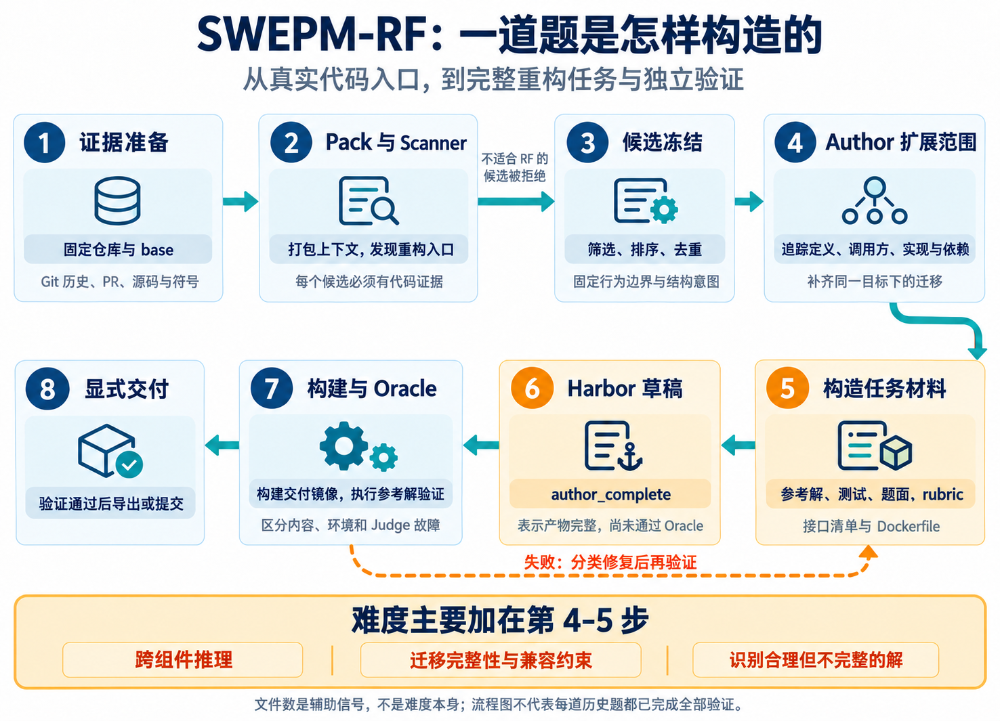

# SWEPM-RF：面向真实软件工程的重构任务构造

SWEPM-RF 聚焦 RF（Refactoring，代码重构）任务：从真实仓库的代码与开发历史中发现结构改造机会，将它们构造成需求明确、环境可复现、结果可验证的软件工程实例。

我们的目标是让模型完成真实的仓库级重构：理解现有设计，追踪依赖和调用关系，完成职责或接口迁移，并保持规定的业务行为。本文介绍整体架构、任务构造方法、难度设计和五个真实案例，也可作为参与造题同学的入门材料。

> 材料范围：本文于 2026-10-28 整理，流程与案例依据此前于 2026-10-26 核对的实现和任务材料。本次为文档重组，没有重新运行题目测试或 Oracle。流程要求、案例中的评分要求和实际执行结果需要分别理解。

## 1. 我们构造什么样的 RF 任务

一道 RF 任务由三个部分共同定义：**需要达到的结构目标、必须保持的运行行为，以及需要完整迁移的影响范围。**

例如，“把 WebSocket 鉴权抽成 middleware”不仅要求增加一个类，还要求真实路由使用它、原 consumer 交出鉴权职责，并保持连接拒绝、用户身份和消息权限等行为。

主要关注四类结构变化：

| 类别 | 结构目标 | 示例 |
| --- | --- | --- |
| 职责抽取（Extraction） | 将内聚职责抽成可复用组件 | 从 consumer 抽出连接鉴权 |
| 职责拆分（Decomposition） | 分离混合在一起的处理阶段 | 将语法解析与 import 展开分开 |
| 接口演进（Interface Evolution） | 改进接口表达并迁移相关调用方 | 将裸指针与长度统一替换为 span |
| 归属调整（Relocation） | 调整实现、状态或模块的归属 | 将后端专属算法移入对应后端 |

以新增功能、修复 bug、机械改名、格式化或测试代码调整为主体的候选，不作为这里的 RF 任务。接口演进可以要求删除旧 API；“保持行为”具体指题面约定的运行语义与兼容边界，并不意味着必须保留所有旧接口。

一份可交付实例包含固定的仓库版本、题面、参考解、测试、结构评分规则与运行环境。模型最终提交的是仓库修改，验证器检查其是否满足完整任务要求。

## 2. 整体架构：从代码证据到可验证实例

整个流程分为发现候选、构造任务、独立验证与交付三个阶段。图中的失败回路表示需要分类修复再验证，不表示所有修复都由一个自动闭环完成。

### 2.1 发现候选：从真实代码中确定重构入口

| 模块 | 输入 | 核心工作 | 输出 |
| --- | --- | --- | --- |
| 证据准备 | 仓库快照、Git 历史、PR / issue / review | 固定 base，整理源码与符号证据 | 可追溯的代码和历史材料 |
| Pack | 相关代码与历史片段 | 打包有限上下文并保留来源引用 | 带证据引用的扫描上下文 |
| RF Scanner | Pack | 识别结构问题，提出重构方向与约束 | 重构候选 |
| 筛选与冻结 | 候选集合 | 排序、去重、排除不适合的入口 | 固定 base 与任务契约 |

Scanner 只读取 Pack，通过 LLM 调用发现入口；它不访问完整仓库工具，也不直接生成参考解和完整测试。候选需要说明入口文件和符号、代码证据、重构方向、保留行为、验证机会与风险。

候选排序会参考入口非测试文件数和预计影响文件数，以及重构价值、纯度、证据强度与可构造性。这些是选择信号，不是实测难度分。

冻结之后，仓库版本、来源证据、行为边界和结构意图成为构造依据。入口文件不是修改白名单：后续仍需要沿依赖关系确定完整范围。自动生成的“批准”状态也不等同于逐题人工审核。

### 2.2 构造任务：Author 完成仓库级影响分析

Author 在隔离的 base checkout 上读取完整仓库，沿着定义、实现、调用方、配置和测试追踪影响范围。

它要解决四个问题：

1. **职责应该放在哪里？** 确定新的组件、接口或状态所有权。
2. **哪些生产路径必须迁移？** 找全调用方、实现与初始化入口。
3. **哪些行为不能改变？** 明确输出、错误处理、权限、状态和兼容要求。
4. **怎样判断已经完成？** 将目标写成测试与可检查的结构要求。

历史修复或重构 patch 可以提供线索，但需要在选定 base 上重新核实。参考解必须实现当前任务契约；不能直接把历史 patch 当作未经核对的答案。

范围扩展必须服务于同一个结构目标。鉴权抽取涉及路由接入、consumer 职责变化，这是必要迁移；无关模块的清理不应被拼入题目。

### 2.3 输出材料：题面、参考解与验证器必须对齐

| 材料 | 作用 |
| --- | --- |
| `task_instruction.md` | 给求解模型的目标、约束、允许变化与兼容边界 |
| `gold.patch` | 满足完整任务要求的一份参考实现 |
| `gold_interface_manifest.json` | 记录接口、保留行为、相关文件与测试身份 |
| `test.patch` | 检查运行行为及可稳定检测的结构要求 |
| `rubrics.json` | 将结构目标拆成原子要求，并定义不合格模式 |
| `environment.Dockerfile` | 重建固定版本源码与必要依赖 |

这些材料必须描述同一个任务。题面应明确要求迁移什么、保留什么；评分规则不能额外要求题面没有交代的设计。参考解的私有 helper 名称或逐行写法，不应成为唯一可接受答案。

材料完成后打包为 Harbor 任务草稿。Harbor 在这里承担任务环境和验证的交付载体，内容生成与后续环境构建、执行验证是分开的阶段。

### 2.4 独立验证与交付：区分三个完成状态

| 状态 | 表示什么 | 尚不能说明什么 |
| --- | --- | --- |
| `author_complete` | 题目材料和任务草稿已生成 | 不代表镜像已构建或参考解已通过 |
| `built_staged` | 交付包与镜像已构建 | 不代表评分器运行成功 |
| `oracle_passed` | 参考解在交付环境中通过验证 | 不代表所有错误解都能被拒绝，也不代表已完成难度标定 |

通过后再显式导出或提交。失败需要区分题目或参考解内容错误、环境错误、Judge 服务错误；基础设施故障不能计作模型遇到的题目难度。

## 3. RF 如何验证：行为正确与结构完成都要满足

重构前的代码通常已经具备业务功能。如果只检查原有测试，完全不修改代码也可能通过。因此，验证需要同时回答两个问题：

| 维度 | 需要回答的问题 | 检查方式 |
| --- | --- | --- |
| 行为正确性 | 输出、错误处理、权限、状态与兼容性是否保持？ | 优先使用确定性测试 |
| 结构完成度 | 职责是否迁移，调用方是否接入，旧路径是否按要求清理？ | 稳定结构检查与必要的 rubric Judge |

例如，在 Paperless 案例中，新增了 middleware 却没有接入 ASGI 路由，可能不会破坏旧测试，但重构目标仍未完成。反过来，如果职责拆分完成却放行了未登录连接，也应判定失败。

验证设计应覆盖以下对象；是否执行需要对应运行记录：

| 检查对象 | 预期结果 | 检查目的 |
| --- | --- | --- |
| 原始 base + 原有测试 | 通过 | 确认基线和环境健康 |
| 原始 base + 新重构要求的检查 | 不通过 | 防止空提交通过 |
| 参考解 + 原有测试 | 通过 | 检查行为回归 |
| 参考解 + 新要求测试与 rubric | 通过 | 检查完整任务契约 |
| 合理但不完整的实现 | 因明确缺口而不通过 | 检查验证器的区分能力 |

“合理但不完整的实现”称为 **near miss（近似解）**，例如漏迁移一个调用方、保留被要求删除的旧接口，或改变 snippet 作用域。语法错误、随机删代码、故意无法编译，都不能作为有说服力的近似解。

Author 阶段要求设计不同类型的近似解与相应检查点；设计完成不等于已生成并执行这些变体。参考解验证、近似解验证和独立盲解的结果应分别记录。

## 4. 难度怎样加入任务

**难度来自完成同一重构时必须共同满足的真实约束。** 我们主要在入口选择、影响范围扩展和验证设计中提高任务要求。

| 难度来源 | 构造方法 | 模型需要具备的能力 |
| --- | --- | --- |
| 跨组件理解 | 沿定义、实现、调用方和配置展开任务 | 识别实际调用链与依赖关系 |
| 迁移完整性 | 要求新组件投入使用，并清理指定旧路径 | 完成整条链路，而非局部替换 |
| 行为与兼容约束 | 保留权限、错误、状态、初始化或旧入口语义 | 在改变结构的同时控制行为回归 |
| 状态与生命周期 | 明确状态由谁持有、何时创建和清理 | 理解执行顺序与所有权 |
| 近似解区分 | 为遗漏要求的方案设计可解释检查 | 满足完整契约，而非只让现有测试通过 |

例如，Paperless 的一个局部入口可以扩展为同一条 WebSocket 状态更新链路上的完整迁移：

这张图是对案例要求的教学拆解，不是历史生成轨迹。难点包括：middleware 的执行顺序、身份信息何时可用、生产者与消费者协议一致性、owner 可见性，以及旧鉴权路径的移除。

### 文件数和代码行数只是辅助指标

跨文件范围可以提示任务复杂度，但不能通过拆文件、格式化或附带无关清理来增加难度。大量代码移动可能产生很大的 diff；只改两个文件也可能涉及复杂的作用域和错误定位语义。

下表是后文五个案例参考补丁的静态计数，来自 2026-10-26 的材料记录：

| 案例 | 触及文件数 | 新增行 | 删除行 | 新增 + 删除 |
| --- | ---: | ---: | ---: | ---: |
| Paperless | 4 | 82 | 42 | 124 |
| nghttp2/nghttpx | 9 | 58 | 44 | 102 |
| Maddy | 2 | 153 | 77 | 230 |
| pandas_profiling | 23 | 2,123 | 1,887 | 4,010 |
| HiGHS | 8 | 578 | 513 | 1,091 |

统计按 patch 文件块与新增、删除行计算，没有排除空行、注释或代码移动。这是五个案例的补丁规模，不是净新增逻辑量、统一门槛或整个任务集的分布。

### 设计难度与实测难度分开报告

任务要求更多跨组件推理，不意味着已经证明通过率下降。实测难度需要固定 solver、harness、推理配置和预算，进行不暴露参考解的独立求解，并报告成功率、步数、token 与环境失败情况。任务元数据中的难度标签不能代替这些实验。

## 5. 真实任务案例

以下五个案例来自已有 RF 实例，按题面与评分规则整理。保留实例 ID 便于追溯；中文介绍不替代完整题面。本次没有重新执行这些案例，也没有逐题核验历史 Oracle 结果，因此不将它们标注为已认证案例。

阅读时重点关注：**原有结构问题是什么、最终要形成什么结构、哪些行为必须保留、哪些近似实现应被拒绝。**

### 5.1 Case A：Paperless WebSocket 鉴权与消息协议拆分

**实例 ID：** `swe-rf-005450b875947d0ffca94e77`

**原有问题。** 状态消息的 WebSocket consumer 同时负责连接鉴权和消息发送细节；consumer 与进度生产者还各自维护 group 名称和事件结构。

**题目要求。** 在 `paperless.websockets` 中提供可复用的鉴权判断函数和 `AuthenticatedWebSocketMiddleware`；用共享的 `status_updates` 组件集中管理 group 名称、事件构造、payload 提取与 owner 可见性判断。将 middleware 接入真实 ASGI 调用链，让 `StatusConsumer` 和 `ProgressManager` 使用共享协议。

**必须保持的行为。** 未登录连接在 connect 阶段被拒绝，已登录连接正常接受；订阅组仍是 `status_updates`；`status_update` 事件中的 `data` 原样作为 JSON 转发；owner 过滤规则和断开连接后的清理保持不变。

**评分规则中的不合格实现。** 新建了鉴权 middleware，却没有接入 ASGI；consumer 仍自己决定是否允许连接；生产者与消费者仍分别拼装同一套协议。

**教学观察。** “抽出一个类”只是中间动作。构造这类题目，需要明确职责迁移的起点和终点，并检查生产调用链确实经过新组件。

### 5.2 Case B：nghttp2/nghttpx 从裸指针接口迁移到 span

**实例 ID：** `swe-rf-0027cba51b40bce51527fe6b`

**原有问题。** 多个读缓冲区接口分别传递目标地址和容量，调用者需要自行保证二者匹配。

**题目要求。** 为 `Buffer<N>` 和 `MemchunkBuffer` 增加可写 `std::span<uint8_t>` 视图；把 `Memchunks::remove` 的目标缓冲区接口，以及 `Connection::read_tls`、`read_clear`、`read_nolim_clear`、`peek_clear` 改为接收 span；同步迁移调用方。题目明确要求删除这些旧的指针加长度接口，不保留兼容重载。

**必须保持的行为。** 部分读取、零长度读取、EOF、错误处理、限速计数、TLS 重试状态，以及分块缓冲区部分或全部移除后的状态都要保持正确。写入不能超过 span 容量，返回值必须是真实处理的字节数。

**评分规则中的不合格实现。** 只改普通读取、漏掉 TLS 或 peek 路径；增加 span 重载却保留旧接口；签名已经改了，内部仍按错误长度复制或破坏分块缓冲区状态。

**教学观察。** 接口演进题需要列清接口族和调用方范围。这里允许、且要求改变指定的源码接口；“保持行为”指运行语义，不能理解为所有旧 API 都必须保留。

### 5.3 Case C：Maddy 配置解析与 import 展开解耦

**实例 ID：** `swe-rf-0075500a832addf26e833e72`

**原有问题。** `config/parse.go` 中的 `parseContext` 同时负责 token 解析、Node 树构建、snippet 收集、import 文件查找和展开，解析状态与文件 I/O 耦合。

**题目要求。** 让 `parseContext` 仅负责原始 Node 树构建及括号、嵌套合法性检查。把 import 和 snippet 展开迁移到独立组件，通过 `ImportSource.OpenImport(...)` 提供导入内容，并增加 `FileImportSource` 和 `ReadWithImportSource(...)`。原有 `Read` 仍默认使用文件系统。

**必须保持的行为。** 嵌套 import 相对于包含该指令的文件解析；展开节点和错误保留正确的文件、行号信息；同文件的 snippet 可在声明前被引用。父文件的 snippet 对被导入文件不可见，但被导入文件提供的 snippet 可供导入方后续使用。返回树中不保留 snippet 声明。

**评分规则中的不合格实现。** 只增加一个 `ReadWithImportSource` 包装入口，实际展开逻辑仍留在 `parseContext`；把父子文件的 snippet 放入同一个共享作用域，改变原有可见性规则。

**教学观察。** 解析器重构的关键约束往往藏在作用域、相对路径和错误定位中。造题时，应把这些容易被重构破坏的语义写成具体、可检查的要求。

### 5.4 Case D：pandas_profiling 后端分层与旧入口兼容

**实例 ID：** `swe-rf-000223026eae9eb2f8ed4c6f`

**原有问题。** Pandas 专属的统计、相关性计算、重复值、采样和图像头处理散落在通用 `model` 模块中，通用入口与具体后端实现混在一起。

**题目要求。** 增加按 dataframe/series 运行时类型分派的 backend registry，将 Pandas 实现移入 `pandas_profiling.model.pandas`。旧的通用模块保留为委托或重新导出的兼容入口；仅导入 `pandas_profiling` 就应自动注册 Pandas 后端并应用 JPEG 图像头补丁。

**必须保持的行为。** `ProfileReport` 的变量摘要、表统计、重复值、采样与相关性结果保持兼容；URL 类型激活和关闭相关性计算等配置继续生效；`describe_1d`、`get_table_stats` 等旧导入方式仍可使用。

**评分规则中的不合格实现。** 有 registry，但使用者必须额外手动导入后端；后端注册了，算法实现仍留在通用模块；移动代码后破坏旧导入路径。

**教学观察。** 模块拆分题要同时描述实现归属、入口分派和兼容边界。初始化副作用也是契约的一部分，需要明确何时触发。

### 5.5 Case E：HiGHS 求解器搜索执行层抽离

**实例 ID：** `swe-rf-0041eb1130e06b53a7929544`

**原有问题。** `HighsMipSolver::run()` 直接承载初始化后的根节点计算和分支定界搜索，同时负责外围的准备和收尾，搜索状态的归属不够独立。

**题目要求。** 将初始化后的执行逻辑移到 MIP 组件中的专用 worker，由 worker 持有每次求解的搜索和 separation 状态。`run()` 继续负责分析准备、预求解、setup 和最终清理、报告，并把中间执行委托给 worker。同步更新构建和头文件依赖。

**必须保持的行为。** 根节点启发式、重启、节点队列、局部 domain 更新、cut/conflict aging、limit 和终止处理保持原有语义；公共 `Highs` API 与选项语义保持不变。

**评分规则的具体检查点。** 规则要求 `HighsMipWorker` 持有 `HighsSearch` 和 `HighsSeparation` 并连接现有 LP relaxation，更新 CMake 与 Meson；还要求固定 `small_mip` 案例的串行和并行结果保持一致。这些是评分要求，本次未运行验证。

**评分规则中的不合格实现。** 新建了 worker 文件，但 `run()` 仍直接持有搜索对象；只移动部分循环而漏掉 separation 或 LP relaxation 连接；将最终清理、报告也搬到 worker，越过指定职责边界。

**教学观察。** 复杂算法的重构题需要明确状态所有权、执行顺序和生命周期边界。仅凭函数变短，无法判断重构是否完成。

### 5.6 五个案例的对照

下表是基于以上案例的教学归纳，不是对整个 RF 数据集的统计结论。

| 案例 | 主要结构变化 | 需要重点检查的契约 | 容易出现的不完整实现 |
| --- | --- | --- | --- |
| Paperless | 鉴权与消息协议抽取为共享组件 | 连接鉴权、消息内容、owner 可见性 | 新组件没有接入实际调用链 |
| nghttp2/nghttpx | 指针与长度接口统一迁移到 span | 缓冲区边界、读取和重试语义 | 只改部分接口或保留被禁止的旧接口 |
| Maddy | 原始解析与 import/snippet 展开分离 | 路径、作用域、源码定位 | 只加包装入口，职责仍未迁移 |
| pandas_profiling | 通用入口与 Pandas 后端分层 | 旧导入、报告输出、自动初始化 | 代码仍属于旧层，或兼容入口失效 |
| HiGHS | 求解准备与搜索执行分层 | 状态所有权、算法语义、构建接入 | 只搬部分循环，遗漏状态和生命周期 |

讨论时可以针对其中一道题，分别写出“结构目标”“行为约束”和“一个应被拒绝的近似实现”，再对照原题与评分规则讨论。

## 6. 如何构造一条新的 RF instance

1. **写清结构问题。** 用生产代码证据解释混合职责、接口缺陷或归属问题，确认属于 RF。
2. **固定 base 与行为边界。** 列出必须保持的运行行为，以及明确允许改变的接口。
3. **追踪完整影响范围。** 查找定义、实现、调用方、初始化、配置与构建接入，为每项迁移说明必要性。
4. **将目标写成可检查要求。** 区分结构结果与行为约束，让题面、参考解、测试和 rubric 逐项对应。
5. **设计至少两类近似解。** 说明它们为什么看起来合理、遗漏了什么，以及应该由哪项检查拒绝。
6. **交付完整材料。** 生成参考补丁、接口清单、测试、rubric、题面与运行环境，再打包任务草稿。
7. **独立验证并记录状态。** 区分内容生成、镜像构建、参考解通过与实际难度评估，分类处理失败。

完成设计后，应能回答：**这道题要求模型协调哪些真实约束？为什么一个看起来正确的局部改法仍然不够？**

## 7. 文件使用方式

本目录包含正文与两张 PNG 配图，使用相对路径引用。对外分享时复制整个 `SWEPM-RF` 目录，或发送对应 ZIP 并解压后打开 `SWEPM-RF.md`。正文不依赖内部仓库链接。
