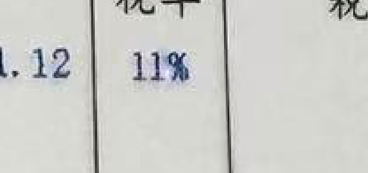
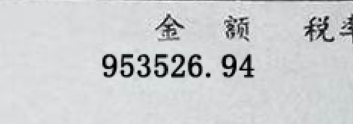
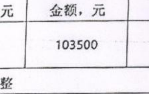
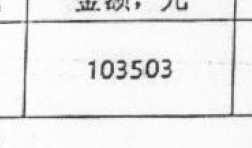

# 金融材料题目案例：真实输入、标注与 Luna 回答

以下四题均来自已执行的 30 题小试。本公开版本只展示数值／日期局部示例，Luna 回答直接从保存的结果复制，未改写。模型实际收到的是约 1300px 的整页图片，局部示例没有作为解题输入。标注答案与点评只用于事后核对，没有提供给解题模型。

运行配置：Codex CLI 0.164.0 + `gpt-6-luna`，请求 `medium` effort，每题独立会话、一次尝试。实际未调用工具探索；图片最大边通常约 1300px。内容分不包含位置框评分。

这是一份带答案的案例说明，不应作为隐藏测试输入直接提供给模型。现有标注只覆盖已核实范围，不保证整页或全文修改均已列出。

## 共同题面

### 单文档判断题的实际题面

```text
你是一名金融材料内容核验员。仅检查附件中的这一页；没有提供原件，也没有提供修改位置。
任务：判断是否有充分证据怀疑关键业务内容被编辑。请综合可见的局部图像痕迹与金额、日期、字段关系；正常拍照、压缩、扫描、软件导出本身不能直接证明业务内容被改。金额计算允许分位舍入造成的不超过0.02元误差。不要臆测修改前的数值，也不要把未发现证据说成业务真实。
只输出JSON，不要写分析过程或Markdown：
{"decision":"suspicious|no_clear_evidence|insufficient", "evidence":[{"page":1,"field":"涉及字段","bbox":[0.0,0.0,1.0,1.0],"observed_value":"可读值或空字符串","reason":"可直接核验的简短依据"}],"summary":"结论"}
bbox必须是相对附件整张图片的归一化xyxy坐标。最多报告4处最有依据的异常；没有异常时evidence可以为空。不得把纸张拍摄畸变、普通字体差异直接当作确定篡改。理由每项不超过100字，summary不超过150字。
```

### 原改对比题的实际题面

```text
附件依次为同一来源材料的编辑前页A和编辑后页B。仅检查给出的两页，不推断未提供的页面。
任务：找出关键业务字段的内容差异，并给出两侧位置。区分真正内容变化与旋转、压缩、清晰度、裁切、版式差异；无法辨读的字符明确写不确定。不要推断编辑动机或业务真假。
只输出JSON，不要写分析过程或Markdown：
{"changes":[{"field":"字段","before":"A中的值","after":"B中的值","page_a":1,"page_b":1,"bbox_a":[0.0,0.0,1.0,1.0],"bbox_b":[0.0,0.0,1.0,1.0],"reason":"短依据"}],"summary":"结论"}
bbox是相对各自附件整张图片的归一化xyxy坐标；page_a/page_b使用附件顺序内的页号1，不是原PDF页码。最多报告8处具体内容变化，理由每项不超过80字，summary不超过150字。若无可靠内容差异，changes为空。
```

## 四道实际题目

### Q01：单文档判断：漏掉税率与税额矛盾

材料类别：发票。使用上述 **单文档判断** 共同题面。[原始题面文件](prompts/single.txt)。

#### 模型输入说明与公开局部示例

模型实际输入为整页图片；为避免公开主体、个人和账户信息，此处仅展示目标字段的局部示例。局部图用于阅读说明，未作为该题的模型输入。

**待检页目标字段局部**



#### 后台标注答案：模型未看到

| 字段 | 编辑前 | 编辑后 |
|---|---|---|
| 明细第1行税率 | 13% | 11% |

这是用于建立编辑事实的配对标注；单文档题不要求模型恢复后台原值，而是给出当前图片支持的异常证据。

#### Luna 原始回答

```json
{
  "decision": "no_clear_evidence",
  "evidence": [],
  "summary": "可见金额关系一致：438321.12元加56981.74元等于价税合计495302.86元；数量711630乘单价0.6159396246约为金额438321.12元。仅凭本页未见足以怀疑关键业务内容被编辑的证据，不能据此确认业务真实。"
}
```

#### 核对结果

**临时内容分：0/10。** 漏掉税率11%与税额的矛盾：438321.12×11%=48215.32，而税额为56981.74。模型只核对加总，未核对税率。

可复核关系：`438321.12 × 11% = 48215.3232`，四舍五入为 `48215.32`；页面税额却为 `56981.74`。只检查“金额 + 税额 = 合计”会漏掉这一矛盾。

[该题保存的运行结果](data/case-results/Q01.json)

---

### Q13：单文档判断：正确发现明细金额异常

材料类别：发票。使用上述 **单文档判断** 共同题面。[原始题面文件](prompts/single.txt)。

#### 模型输入说明与公开局部示例

模型实际输入为整页图片；为避免公开主体、个人和账户信息，此处仅展示目标字段的局部示例。局部图用于阅读说明，未作为该题的模型输入。

**待检页目标字段局部**



#### 后台标注答案：模型未看到

| 字段 | 编辑前 | 编辑后 |
|---|---|---|
| 明细行金额（供电电费行） | 988239.82 | 953526.94 |
| 明细行税额 | 128471.18 | 123958.50 |

这是用于建立编辑事实的配对标注；单文档题不要求模型恢复后台原值，而是给出当前图片支持的异常证据。

#### Luna 原始回答

```json
{
  "decision": "suspicious",
  "evidence": [
    {
      "page": 1,
      "field": "金额",
      "bbox": [
        0.606,
        0.41,
        0.673,
        0.433
      ],
      "observed_value": "953526.94",
      "reason": "该行金额与合计金额988239.82不一致；数量1689566乘单价0.5849074987357约为988239.82，且该合计与13%税额及价税合计相符。"
    }
  ],
  "summary": "行金额与数量、单价及合计之间存在明显不一致，足以怀疑关键业务字段异常；仅凭此页不能确认是否由编辑造成，也不能推断原值。"
}
```

#### 核对结果

**临时内容分：10/10。** 正确发现明细金额953526.94与合计988239.82及数量×单价不一致，命中已标注修改字段；单图不要求恢复编辑前数值。

本题的 10 分表示单文档判断命中至少一个已标注目标并有有效依据，不表示模型列出了全部修改字段。后台还标注了税额变化，Luna 本次只报告金额异常。

[该题保存的运行结果](data/case-results/Q13.json)

---

### Q07：原改对比：日期读对，但位置框偏移

材料类别：合同。使用上述 **原改对比** 共同题面。[原始题面文件](prompts/paired.txt)。

#### 模型输入说明与公开局部示例

模型实际输入为整页图片；为避免公开主体、个人和账户信息，此处仅展示目标字段的局部示例。局部图用于阅读说明，未作为该题的模型输入。

**编辑前局部**


**编辑后局部**


#### 后台标注答案：模型未看到

| 字段 | 编辑前 | 编辑后 |
|---|---|---|
| 甲方签章日期 | 2025年04月30日 | 2025年04月04日 |

#### Luna 原始回答

```json
{
  "changes": [
    {
      "field": "甲方签署日期",
      "before": "2025年04月30日",
      "after": "2025年04月04日",
      "page_a": 1,
      "page_b": 1,
      "bbox_a": [
        0.15,
        0.84,
        0.36,
        0.86
      ],
      "bbox_b": [
        0.05,
        0.78,
        0.29,
        0.8
      ],
      "reason": "日期中的“30”变为“04”；其余差异未见可靠内容变化。"
    }
  ],
  "summary": "仅发现甲方签署日期不同：A为2025年04月30日，B为2025年04月04日。"
}
```

#### 核对结果

**临时内容分：10/10。** 前后日期正确，但修改侧框的纵坐标明显偏离目标。内容分不包含框分。

该字段的双侧框 IoU 分别为 `0.2265` 和 `0.0`。因此内容分满分仍不代表完成了准确定位。

[该题保存的运行结果](data/case-results/Q07.json)

---

### Q24：原改对比：发现合同金额末位变化

材料类别：合同。使用上述 **原改对比** 共同题面。[原始题面文件](prompts/paired.txt)。

#### 模型输入说明与公开局部示例

模型实际输入为整页图片；为避免公开主体、个人和账户信息，此处仅展示目标字段的局部示例。局部图用于阅读说明，未作为该题的模型输入。

**编辑前局部**



**编辑后局部**



#### 后台标注答案：模型未看到

| 字段 | 编辑前 | 编辑后 |
|---|---|---|
| 合同表格金额 | 103500 | 103503 |

#### Luna 原始回答

```json
{
  "changes": [
    {
      "field": "金额（元）",
      "before": "103500",
      "after": "103503",
      "page_a": 1,
      "page_b": 1,
      "bbox_a": [
        0.637,
        0.285,
        0.699,
        0.294
      ],
      "bbox_b": [
        0.723,
        0.314,
        0.787,
        0.325
      ],
      "reason": "金额栏末位不同：A为0，B为3。"
    }
  ],
  "summary": "两页可辨认的关键业务字段差异为金额栏：A显示103500元，B显示103503元。"
}
```

#### 核对结果

**临时内容分：10/10。** 金额103500→103503的细微差异正确。

[该题保存的运行结果](data/case-results/Q24.json)

---

## 文件入口

- [实验格式、解题方式与评分说明](EXPERIMENT_NOTE.md)
- [30 题汇总结果](data/summary.json)
- [四题保存的模型回答](data/case-results/)

本公开版本不含整页材料与完整后台标注，不能作为完整实验复现包。此处公开的图片仅含选定字段局部，模型实际使用的整页输入留存在本地。
