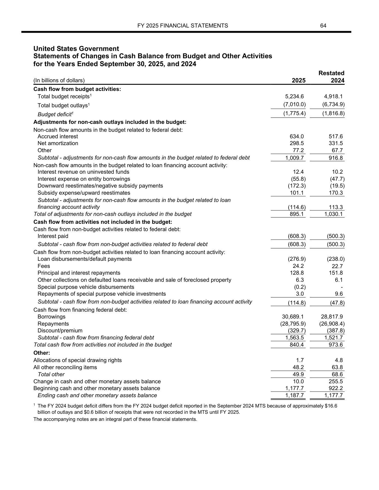
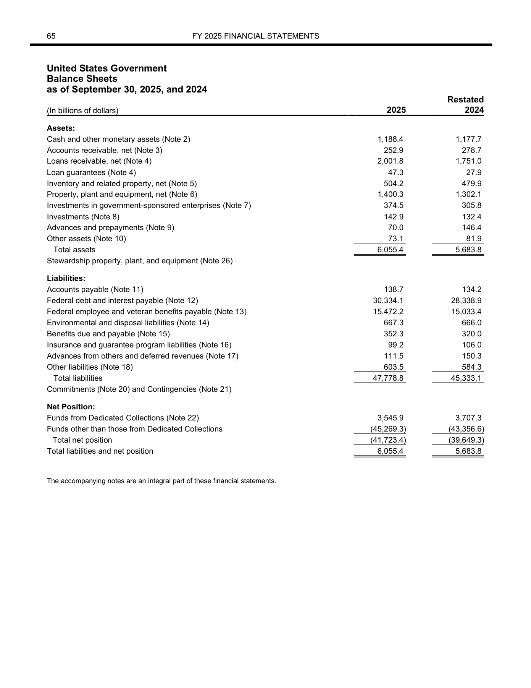

# 金融材料修改模式：扫描分类与公开题目案例

整理日期：2026-11-04。本报告保留前期扫描的汇总分类，具体案例全部使用公开财报构造题。原敏感材料的字段值、主体标识、文件名和页面不在本次发布范围内。

前期材料既有局部字符修改，也有多字段、跨页联动。题目应区分准确读值、字段绑定、关系核验与视觉变化检测，不能仅凭读到数值差异就断言存在欺诈。

## 1. 扫描范围与证据边界

前期分析基于2026-10-28保存的站点快照。本轮扩大的是目录主题覆盖面，没有取得全部材料的新详情或新增图像证据，没有重新评测这些敏感材料。

| 范围 | 数量 | 能说明什么 |
|---|---:|---|
| 完整目录 | 976份 | 材料类型、台账状态与已列字段 |
| 有已列修改字段 | 823份 | 可以筛选字段主题 |
| 无已列修改字段 | 153份 | 不能直接当作干净负例 |
| 目录修改记录 | 1,094条 | 一条记录可能包含多个字段 |
| 列出多条修改记录的材料 | 158份 | 不等于跨页修改或修改已穷尽 |
| 已保存完整详情 | 63份 | 有前后值或变化描述，并非全部逐页目视核验 |
| 详情中台账标为已确认 | 43份、67条记录 | 属于原台账状态，尚非独立人工金标认证 |

目录材料类型为征信报告390份、合同241份、发票190份、税务50份、网银50份、营业执照50份、其他5份。类型沿用原目录，个别归类可能与正文不完全一致。

目录台账状态为已确认784份、未确认原件137份、未确认修改字段34份、未确认修改位置11份、仅文档层差异10份。候选文件存在不等于配对已核实；没有列出修改不等于没有修改。

## 2. 扫出的字段主题

剥离检索字段中的原件文件名后，对标注字段名称做关键词匹配。同一材料可命中多个主题，上下文也可能触发匹配；下表是筛选候选题的目录统计，不是修改机制发生率，更不是现实金融欺诈分布。

| 字段主题 | 命中材料数 | 其中台账已确认 |
|---|---:|---:|
| 日期、时间 | 268 | 265 |
| 金额、余额、资本 | 253 | 235 |
| 信用分类、逾期及还款表现 | 125 | 125 |
| 身份、主体及收款标识 | 106 | 101 |
| 交易数量、账户数及笔数 | 68 | 67 |
| 文档及业务编号 | 40 | 38 |
| 水印、徽标及版式 | 32 | 30 |
| 界面外围信息 | 21 | 20 |
| 税费率 | 9 | 9 |
| 合同履约条款，仅合同类 | 8 | 3 |
| 联系方式 | 6 | 6 |

征信目录还可筛出分类相关80份、逾期概要或逐月还款表现25份、担保或相关还款责任26份；集合存在重叠。后两类以及合同条款仍需补齐前后值、账户对应关系、上下文和页面证据，才能形成确定答案。

## 3. 修改机制与已构造公开case

字段主题回答“改了什么”，修改机制回答“变化如何关联”。以下九类来自前期详情归纳，彼此可以重叠，尚未在976份目录上逐份确认，不能报告为全量机制占比。

所有数值示例均来自美国财政部公开财报的研究修改件。P为基础轮题号，H为升级轮题号；公开财报没有覆盖原材料的全部文种。

| 前期归纳的机制 | 公开构造案例 | 核查能力与覆盖边界 |
|---|---|---|
| 少数字符替换 | P05总收入5,244.6→5,344.6；H07末位小数修改 | 读值与准确定位，小改动不等于小业务影响 |
| 局部改值、关联字段未同步 | H01现金1,187.7→1,188.4，贷款应收2,002.5→2,001.8 | 本页资产合计保持，但另一页现金仍为1,187.7 |
| 多字段联动、部分关系自洽 | H02/H03同一版本修改10个关联位置 | 本页主要关系成立，其他报表未同步；两题并非独立样本 |
| 跨页联动修改 | H10三页年度与单位标签共11处变化 | 已覆盖标签联动，尚未覆盖金额跨页完整同步 |
| 数值互换或置换 | H04三页9处单元格置换 | 数字集合可保持不变，必须绑定科目和列 |
| 日期和时间锚点 | H10年度标签2025→2026 | 尚未覆盖完整日期链与无效日历日期 |
| 身份、主体或收款标识替换 | 当前公开题尚未覆盖 | 可用虚构主体、账号的自建材料补充；合理格式不能保证真实性 |
| 空白、零与非零之间变化 | P09公开表格字段122.5→0.0 | 非零变零已有案例，空白单元格增删尚未覆盖 |
| 水印、徽标及版式变化 | 暂无正例；P07、H08为正常处理对照 | 正常重编码、页序变化不应自动判作业务篡改 |

本次公开题还增加了单位尺度与正常重述对照。H09只把billions改成millions，数值和页内加总不变，但跨表金额尺度相差1000倍；H06使用两张未经实验编辑的官方页面，要求辨别原报与Restated列的合法口径变化。

## 4. 具体题目、图片与Luna结果

[难度递进实验](PUBLIC-FINANCIAL-BENCH-DIFFICULTY.md)包含两轮各10题的配置与结果、H01/H09实际整页图片，以及H06/H07的回答和评分依据。基础轮临时内容完成分95.00/100，升级轮62.92/100；两轮题目不同且高度同源，不是严格因果比较或正式benchmark成绩。

以H01为例，修改后的资产负债表现金增加0.7，贷款应收减少0.7，资产合计保持6,055.4；现金余额变动表期末现金仍为1,187.7。Luna回答`no_clear_evidence`，漏掉跨页差异。

| H01未改现金余额变动表 | H01修改后资产负债表 |
|---|---|
|  |  |

这两张是模型实际输入页面；修改框和答案没有提供给模型。完整案例入口：

- [基础轮：10题、题面、原始回答与评分](public-financial-pilot/README.md)。
- [升级轮：10题、多页关系与完整差异枚举](public-financial-hard/README.md)。
- [升级轮审阅页：图片、标记与实际回答](public-financial-hard/report.html)。
- [升级轮修改真值](public-financial-hard/private/ground_truth.json)与[逐题核分](public-financial-hard/manual_grading.json)。

答案和审阅标记用于检查，不属于解题输入。公开题使用原生PDF文本修改再渲染PNG，尚未验证真实Photoshop或生成式修补的编辑分布。

## 5. 如何形成benchmark或训练数据

建议分别组织三种任务：双版本差异定位、单文档内部一致性核查、视觉与版式变化检测。双版本应报告字段、前后值与页面归属；单文档应要求可验证的关系证据；视觉任务应单列水印与布局结果。

若修改后的身份标识或日期仍合法，且没有参照或内部矛盾，单页通常无法确定哪一个值被改过。此类样本更适合有参照版本的任务。正常重述、重新导出与重编码应作为独立确认的对照，避免把所有差异都判作异常。

训练前需确认版本配对、字段位置、关系证据和使用权限。训练与测试应按原件、主体和模板检查分组，避免同源变体泄漏；前期材料的预留成员归属尚未解决，不能直接全量用于训练或调参。公开题的两个年度报告也来自同一发布方，目前仅用于开发探索，尚无独立测试集。

下一步应扩展独立发布方、模板与中文文种，并对缺失的身份标识、完整日期链、合同条款和水印正例补充可公开的自建材料。当前交付完成了分类整理和公开案例映射，没有完成976份全文复核，也没有完成独立金融专家金标认证。
