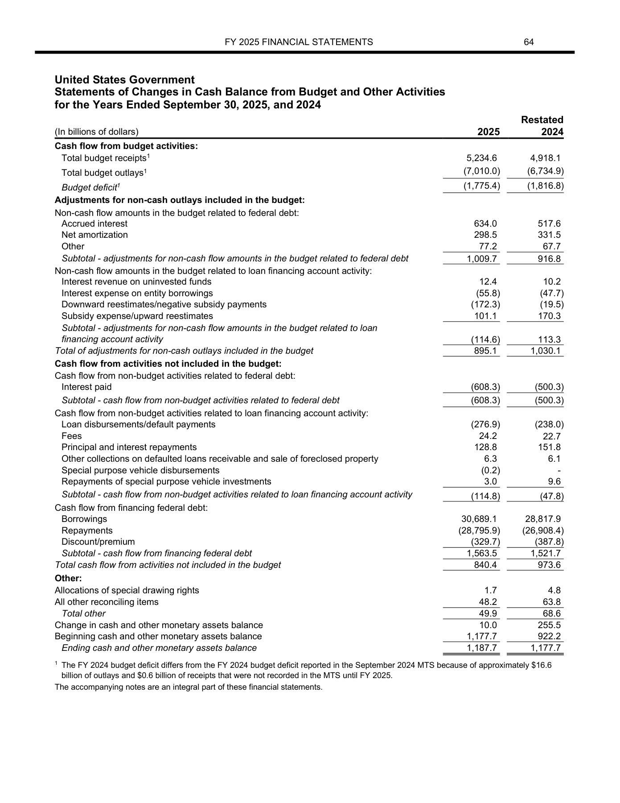
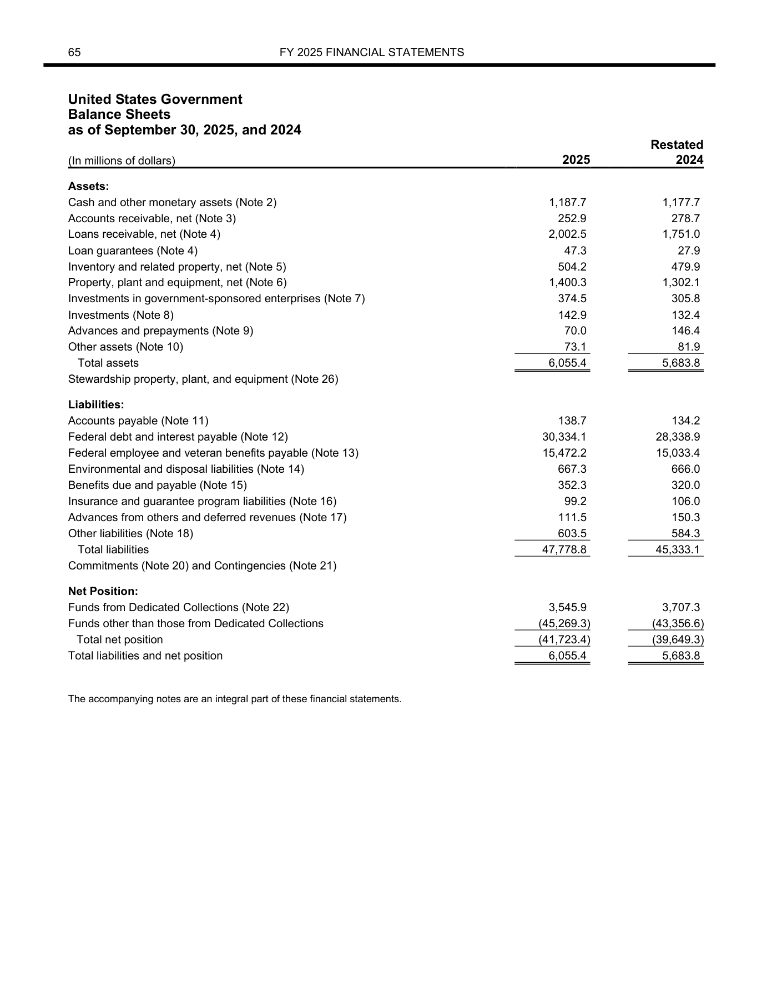

# 公开金融文档核查：难度递进实验

日期：2026-11-04。

我们使用公开财务报表构造了两轮各10道题，并通过Codex运行Luna盲答。基础轮的临时内容完成分为 **95.00/100**；升级轮为 **62.92/100**，完整完成 **4/10题**。升级轮保留相同模型、reasoning effort和图片清晰度，增加跨页核查、重复字段枚举、单位和年度理解，以及正常重述对照。

初步观察是：**公开材料可以构造有区分度的题目，难度不只来自识别文字，还来自正确匹配报表口径、应用单位，以及区分合法变更和异常。** 两轮是开发小样，题目内容及页数不同，不能把分差解释成严格的因果结果，也不能当作正式benchmark成绩。

## 1. 公开来源与题目构造

两轮均使用美国财政部公开财务报表分册，未使用原先的敏感金融材料：

- [2024年度财务报表原始PDF](https://fiscal.treasury.gov/system/files/files/reports-statements/financial-report/2024/financial-statements-2024.pdf)。
- [2025年度财务报表原始PDF](https://fiscal.treasury.gov/system/files/2026-03/financial-statements-2025.pdf)。

本轮选取净成本表、运营及净资产变动表、净运营成本与预算赤字调节表、现金余额变动表和资产负债表，共7个基础页面。

构造方式是修改原生PDF文本，复用原文档字体、字号、颜色和布局，再统一渲染为整页PNG。修改版和对照版会重写相同候选位置，对照版写回原值，以减少插字过程本身成为答案线索的风险。所有研究修改件都与官方原版分开保存。

这轮验证的是公开文档造题和内容核查流程，尚未覆盖真实Photoshop或生成式图像修补的编辑分布。图像长边始终为1800像素，没有通过降低清晰度或裁去必要信息来制造难度。

## 2. 前期归纳的分类，以及公开题目的覆盖

前期材料分析归纳出两种不同的分类维度：一是**修改了什么字段**，二是**修改如何发生、需要什么关系证据才能发现**。下面只保留抽象分类，所有具体case都引用本次公开材料构造，不展示原敏感材料的原件、字段值、文件名或整页图。

按字段主题，前期覆盖日期时间、金额与资本、信用表现、身份主体及收款标识、数量与账户计数、文档及业务编号、税费率、合同履约条款、联系方式、水印版式和界面外围信息。这些主题可以重叠，不能当作互斥类别。

按修改机制，前期归纳的9类模式及当前覆盖如下：

| 修改模式 | 要核查的关键点 | 已构造的公开case与覆盖边界 |
|---|---|---|
| 少数字符替换 | 一个数字或字符变化，业务值可能显著改变 | 基础轮P05：总收入5,244.6→5,344.6；H07包含末位小数变化 |
| 局部改值、关联字段未同步 | 明细、合计或重复字段之间出现矛盾 | 基础轮P01、P05；H01进一步将矛盾放到另一张表 |
| 多字段联动、部分关系自洽 | 一组公式成立不代表全部关系成立 | H02/H03：10处关联修改保持本页主要等式，其他表未同步 |
| 跨页同步修改 | 同一信息在多个页面是否同时改变 | H10已覆盖年度、单位标签跨页联动；金融金额跨页完整联动尚待补充 |
| 字段数值互换或置换 | 数字集合可能不变，但行列归属改变 | 基础轮P03、P08及H04；H04在三页上置换9个单元格 |
| 日期和时间锚点修改 | 报告编号、标题日期、年度列等应正确对应 | H10覆盖年度标签同步修改，尚未覆盖完整日期链和无效日历日期 |
| 身份、主体或收款标识替换 | 新值可保持正常格式，未必产生算术矛盾 | 本次公开报表题尚未覆盖；后续可用虚构主体和账号的自建文档补充 |
| 空白、零和非零之间修改 | 不能把空白状态自动等同于零 | 基础轮P09覆盖122.5→0.0；空白单元格增删尚待补充 |
| 水印、徽标或版式修改 | 区分视觉结构变化与业务字段改值 | 尚未构造此类正例；基础轮P07和H08仅为正常重编码、页序变化对照 |

本轮额外构造了**单位尺度变化**：H09/H10把billions改为millions，检验模型是否理解数值之外的金额尺度。正常对照又加入了**明确重述**与**页序变化**，用于评估误报。

因此，当前已经覆盖多种修改机制，但尚未覆盖前期发现的全部文种和字段。尤其不能把财报题写成已经验证了征信、合同条款、身份标识或水印取证任务。

## 3. 难度如何递进

| 维度 | 基础轮 | 升级轮 |
|---|---|---|
| 题目数 | 10 | 10 |
| 单套核查／双版本对比 | 5／5 | 5／5 |
| 内容修改题／正常对照 | 7／3 | 7／3 |
| 基础页面数 | 4 | 7 |
| 每题整页附件 | 1–2张 | 2–8张 |
| 双版本修改题的目标字段 | 9 | 37 |
| 主要关系 | 局部金额、加总、简单互换 | 页内自洽但跨页冲突、多处联动、单位与年度变化 |
| 正常对照 | 未改内容、正常重编码 | 增加官方重述及页序变化 |

升级轮分为三个方向：

1. **跨页核查**：让修改页内部的加总继续成立，只在其他报表的重复指标中留下矛盾。
2. **完整差异枚举**：同时修改7–11个单元格或标签，要求找全重复位置，并正确绑定页面、科目和列。
3. **金融语义与正常变更**：金额数字不变但单位改变；或两份官方报告因明确重述而出现合法差异。

题目、答案和评分口径在模型调用前冻结，运行后没有依据模型反馈改题或重试。H02和H03共享同一修改版本，分别测试单套核查和双版本对比，不能当作两个独立来源样本。

## 4. 实际结果

| 指标 | 基础轮 | 升级轮 |
|---|---:|---:|
| 临时内容完成分 | 95.00/100 | 62.92/100 |
| 完整完成题数 | 9/10 | 4/10 |
| 单套核查平均内容完成率 | 100.00% | 40.00% |
| 双版本对比平均内容完成率 | 90.00% | 85.84% |
| 双版本正确修改字段 | 7/9 | 31/37 |

总体下降主要来自单套核查的漏检和正常重述的误报。双版本字段召回率本轮为83.78%，基础轮为77.78%；题目和分母不同，因此不能据总体分数断言所有子任务都变难。

升级轮逐题结果如下，每题满分10分：

| 题号 | 构造内容 | 分数 | 实际表现 |
|---|---|---:|---|
| H01 | 现金与贷款应收一增一减，资产合计保持，跨页现金不一致 | 0.00 | 漏检 |
| H02 | 10处关联修改保持页内主要关系，其他表未同步 | 10.00 | 找出跨表净资产矛盾 |
| H03 | 对H02的同一版本做完整差异枚举 | 8.00 | 找对8/10处，漏重复位置 |
| H04 | 三页9处数值置换，数字集合保持 | 7.78 | 找对7/9处，漏Total列 |
| H05 | 四页未修改报表 | 10.00 | 正确保留判断 |
| H06 | 官方原报与明确重述值，无实验编辑 | 0.00 | 把重述差异判为可疑 |
| H07 | 两页7处负号、小数及重复字段修改 | 7.14 | 5/7处归属正确，2处报表与页码错绑 |
| H08 | 页序变化及正常JPEG重编码 | 10.00 | 未虚构内容变化 |
| H09 | 只改单位，金额数字和页内加总不变 | 0.00 | 漏检单位尺度矛盾 |
| H10 | 三页11处年度和单位标签变化 | 10.00 | 全部找对 |

表内逐题分数为显示值，总分使用未四舍五入的逐题分数计算。升级轮有2个未匹配的双版本输出，均来自H07的报表与页面错绑，不是模型捏造了两个全新的数字变化。

## 5. 代表案例

### H01：页内对平后，跨页现金仍然不一致

2025年资产负债表做了两处修改，金额单位均为十亿美元：

| 字段 | 原值 | 修改值 | 变动 |
|---|---:|---:|---:|
| Cash and other monetary assets | 1,187.7 | 1,188.4 | +0.7 |
| Loans receivable, net | 2,002.5 | 2,001.8 | -0.7 |

资产合计保持6,055.4。但现金余额变动表仍列示期末现金1,187.7，且期初现金1,177.7加当期变动10.0也得到1,187.7。

Luna回答 `no_clear_evidence`，没有报告这条同年度、同口径的跨页差异。该题说明，检查单页加总与核对跨页重复指标是不同要求。

以下两张均为H01实际输入的完整页面，点击可查看原分辨率。左图期末现金为1,187.7，右图现金为1,188.4；修改框和答案没有提供给模型。

| 现金余额变动表：题目附件2 | 修改后的资产负债表：题目附件3 |
|---|---|
|  |  |

### H09：所有数字不变，单位相差1000倍

只把资产负债表的单位从 **“In billions of dollars”改为“In millions of dollars”**，所有金额数字保持不变。

现金余额变动表中的期末现金是1,187.7十亿美元；修改后资产负债表的同一指标则成为1,187.7百万美元，即1.1877十亿美元。两者金额尺度明显不一致，而页内加总仍然成立。

Luna仍回答 `no_clear_evidence`。不过，在给出A/B两版的H10中，它又完整指出了单位和年度标签的变化。这支持将“找出版本差异”与“运用单位完成金融一致性核查”分开报告，但不能据此确定模型内部失败原因。

下图为H09的实际资产负债表附件，表头单位是millions；本题同时提供的现金余额变动表和运营表仍使用billions。数字不变，单位变化后金额尺度不同。

### H06：看到了Restated，仍把差异本身当作异常

两张页面都来自未经本实验编辑的官方PDF：2024年度报告列示2024年总资产5,662.1；2025年度报告的 **Restated 2024** 列列示5,683.8。

Luna正确读到了这两个数，也注意到Restated标记，却仍以差额超出舍入范围为理由判为可疑。题面已明确要求不能直接把合法重述差异当作矛盾。

这类正常对照有必要保留：数值不同是观察事实，但仅凭原报与明确重述值不同，不能认定存在本任务所要求的异常证据。这也不等于认证官方材料的全部业务信息真实。

### H07：前后值读对，报表和页码绑定错误

Luna列出了全部7组真实变化的前后数字，但把其中两处 `(0.2) → 0.2` 的负号变化归到了第2页资产负债表，并将字段写为资产负债表中的SEC行。

正确位置是第1页净成本表，资产负债表并没有该SEC行。因此，只有5/7处具备正确的报表、页面和字段归属。这是内容归属错误，不只是边界框偏差。

## 6. 解题方式与评分口径

模型为 `gpt-6-luna`，reasoning effort为medium，Codex CLI版本0.166.0。每题独立临时会话、一次尝试，最多2并发，单题240秒上限，没有反馈重试。

业务材料输入只有题面和整页图片，没有OCR、PDF文本层、候选修改框或答案。实际记录为10个完成回合、10条最终回答、0个工具事件，没有多轮工具探索。这里不把一次CLI会话等同于一次底层HTTP请求。

每题10分，按以下口径计算临时内容完成分：

- 单套异常题：判断正确，且至少提供一条受修改影响、可直接验证的关系证据，才获得10分；不要求猜测哪一侧是原始值。
- 正常对照题：没有虚构异常或业务改值时获得10分。证据不足的回答另记为保留判断，不自动当成篡改误报，但不获得完成分。
- 双版本修改题：按正确目标字段的比例计分；前后值、页面、科目和列归属都要正确，重复位置分别计数。
- 额外输出和错绑另报精确率；边界框保存，但未计入主分。

修改真值来自确定性生成记录，并用文本读回、逐像素范围检查和Decimal算术核验。当前Codex对照这些记录逐题核分，尚未完成独立金融专家复核。

## 7. 对benchmark设计的启发与边界

值得继续发展的任务包括：多页同口径指标核验、单位和符号应用、完整差异枚举，以及官方重述等正常变更辨别。评分应同时覆盖“有没有问题”“证据是否成立”“变化是否找全”和“是否归到正确字段”。

后续可做更严格的匹配实验：固定页面和指标，只改变差额大小、页数或是否提供参照版本，分别观察跨页检索、读值和金融关系核验的影响；再扩展独立发布方、模板和中文文种。

目前两轮都是同一公开发布方的两份年度报表，页面和变体高度同源；升级轮还复用了基础轮来源并依据前轮观察设计新题。因此，这些结果属于开发难度探索，没有独立训练／测试划分，没有统计显著性结论，也没有验证真实图像编辑或实际金融欺诈检测能力。

## 8. 材料入口

- [基础轮实验说明与10题结果](public-financial-pilot/README.md)。
- [升级轮完整实验说明](public-financial-hard/README.md)。
- [升级轮整页审阅：题目、修改框与实际回答](public-financial-hard/report.html)。
- [机器可读评分结果](public-financial-hard/evaluation.json)。
- [逐题核分记录](public-financial-hard/manual_grading.json)。
- [修改真值与跨页关系](public-financial-hard/private/ground_truth.json)。
- [调用前冻结记录](public-financial-hard/freeze_manifest.json)。

审阅页和答案目录仅供检查，不属于模型解题输入。本次整理没有新增模型调用。
