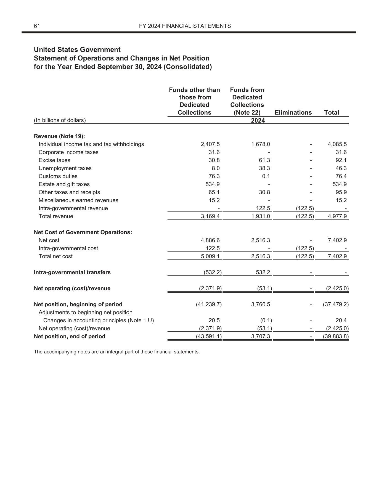

# 公开金融材料造题小试：10道真实来源页面题

日期：2026-11-04。**本包仅使用公开材料，不包含原先的敏感金融文档。修改件全部是研究构造，不代表官方发布内容。**

已完成从公开PDF下载、原生文档修改、整页PNG渲染、题面与答案隔离，到Codex + Luna盲答的流程。数据量为两份年度财务报表、四个基础页面、10道题：5道单页核查、5道双版本对比，其中7道引入内容修改、3道为对照，共12个修改单元格。

## 来源与使用范围

- [TREASURY2024：官方PDF](https://fiscal.treasury.gov/system/files/files/reports-statements/financial-report/2024/financial-statements-2024.pdf)，本地原始文件：[下载副本](sources/TREASURY2024.pdf)，SHA256：`0f3648ec16a69e0c5394d7d674d9f3978221170ea26d63d92277bbcc3d03e451`。
- [TREASURY2025：官方PDF](https://fiscal.treasury.gov/system/files/2026-03/financial-statements-2025.pdf)，本地原始文件：[下载副本](sources/TREASURY2025.pdf)，SHA256：`e8e7d37f155a47b9af7997aecf7aa07041c5d3a1592fddc009ceb3be92e28c31`。

来源是美国财政部2024和2025年度公开财务报表的财务报表分册，选取其中资产负债表和运营及净资产变动表。文件保留原有机构名称、年份和整页布局，文档内金额单位是十亿美元。

选取的是联邦机构编写的财务表格，没有选用第三方照片。联邦雇员在履职中创作的政府作品通常在美国属于公有领域，依据见[美国国会图书馆说明](https://www.loc.gov/legal/security-copyright-and-privacy/understanding-copyright/)。来源清单保存了URL、取得时间和原件哈希；没有将整站所有素材一概视为同一许可。

原始发布版本只是本实验的参照版本，不代表对其会计信息或审计状态作出真实性认证。尤其不能把不同年度报告之间的合法重述当成本实验的篡改真值。

## 10道题目

| 题号 | 输入 | 构造模式 | 修改单元格数 | 运行与核分 | 图片 |
|---|---|---|---:|---|---|
| P01 | 单页 | 现金金额增加，资产合计未同步 | 1 | 10.0/10：完整 | [整页图](questions/P01/page.png) |
| P02 | 单页 | 原值重写对照，无业务内容变化 | 0 | 10.0/10：完整 | [整页图](questions/P02/page.png) |
| P03 | 双版本 | 两个税收项目在两列同时互换，4个单元格变化 | 4 | 5.0/10：部分 | [版本A](questions/P03/page_a.png)、[版本B](questions/P03/page_b.png) |
| P04 | 双版本 | 现金增加、贷款应收减少相同金额，资产总额保持 | 2 | 10.0/10：完整 | [版本A](questions/P04/page_a.png)、[版本B](questions/P04/page_b.png) |
| P05 | 单页 | 总收入修改一个数字，行内及损益关系不一致 | 1 | 10.0/10：完整 | [整页图](questions/P05/page.png) |
| P06 | 双版本 | 贷款担保金额数字换位 | 1 | 10.0/10：完整 | [版本A](questions/P06/page_a.png)、[版本B](questions/P06/page_b.png) |
| P07 | 单页 | 正常JPEG重编码对照，无业务内容变化 | 0 | 10.0/10：完整 | [整页图](questions/P07/page.png) |
| P08 | 双版本 | 同一行两列数值互换，行合计保持 | 2 | 10.0/10：完整 | [版本A](questions/P08/page_a.png)、[版本B](questions/P08/page_b.png) |
| P09 | 单页 | 内部交易成本由非零改零，小计未同步 | 1 | 10.0/10：完整 | [整页图](questions/P09/page.png) |
| P10 | 双版本 | 相同内容的双版本对照 | 0 | 10.0/10：完整 | [版本A](questions/P10/page_a.png)、[版本B](questions/P10/page_b.png) |

题面见 `questions/Pxx/prompt.txt`。输入图片为完整页面，长边1800像素，没有修改框、OCR文字、PDF文本层或答案提示。双版本顺序固定为A、B。单页题没有提供参照图。

审阅入口：[可交互切换的整页题目、答案框及模型回答](report.html)。该入口包含答案，仅供审阅，不属于解题输入。`private/` 是与解题输入分离的答案目录，内容也全部来自本次公开材料构造。

## 三个具体例子

### P01：局部改值，保留可验证的加总矛盾

2024年资产负债表的现金及其他货币资产从 **1,177.7 改为 1,977.7**，总资产仍为5,662.1。原始明细合计为5,662.1，修改后的明细合计为6,462.1，差800.0。这个差异远超一位小数舍入误差，适合单页核查。

### P03：两行两列同步互换，局部关系和合计保持

在2024年运营表中，同时修改以下四个单元格：

| 行 | 列 | A | B |
|---|---|---:|---:|
| Corporate income taxes | Funds other than those from Dedicated Collections | 534.9 | 31.6 |
| Corporate income taxes | Total | 534.9 | 31.6 |
| Estate and gift taxes | Funds other than those from Dedicated Collections | 31.6 | 534.9 |
| Estate and gift taxes | Total | 31.6 | 534.9 |

两行对应列的和仍为566.5，各行内部关系也保持。单纯做加总未必能发现修改；双版本对比应找全四个变化，不能只说“两个数互换”。

| 版本A：保留原值的处理对照 | 版本B：实验修改件 |
|---|---|
|  |  |

### P04：一增一减，资产合计不变

2025年现金及其他货币资产从 **1,187.7 改为 1,287.7**，贷款应收净额从 **2,002.5 改为 1,902.5**，资产合计保持6,055.4。这里保留的是所检查的资产加总关系，不意味着已经验证全文所有会计关系。该题采用双版本输入。

## 构造和质量核验

这批采用**原生PDF文本修改，再统一渲染为PNG**，没有使用Photoshop或生成式图像修补。替换时提取并复用原文档字体、字号、颜色及右对齐位置。为平衡插字痕迹，修改版和对照版会对相同候选单元格执行同样的重写操作，对照版写回原值。

P07另做一次JPEG重编码并保留业务内容，用来检查模型是否把普通导出或压缩误判为篡改。P10是相同内容的双版本对照。

已执行的核验包括：

- 两份源文件及所有题面图片保存SHA256；每次运行前复核实际输入哈希。
- 全部12个原生PDF变体重新读回字段值，并检查全文词项集合只有预期数值替换。
- 七个内容修改变体与各自处理对照逐像素比较，标注区域外没有变化，核验时允许4像素边缘余量。这是修改范围检查，不是逼真度证明，也没有据此宣称像素级真值标注。
- 用Decimal独立复核所选加总、差额和互换关系。
- 本轮目视检查了两张原始页面及P01、P03、P05、P07四个输出，未做独立专家全面复核。

核验文件：[verification.json](verification.json)、[算术关系](private/arithmetic_checks.json)、[完整修改真值](private/ground_truth.json)。

## Luna盲答与评分

模型为 `gpt-6-luna`，reasoning effort为medium，Codex CLI版本0.166.0。每题新建临时会话，单次尝试，最多2并发，单题超时240秒，没有根据答案反馈重试。配置关闭命令执行、网页搜索、图片读取工具和多代理，图片直接作为附件输入。实际工具事件以保存的运行结果为准。

JSON schema限制证据或修改条数，提示要求简短回答；没有宣称设置了CLI硬输出token上限。一次CLI会话不等于已证明底层仅有一次HTTP请求。

单页修改题只有在判断和可验证理由都成立时获得10分；对照题正确保留判断获得10分。双版本修改题按找对的修改字段比例计分，字段必须同时具有正确前后值及行列归属；额外误报另外统计。边界框保存但不计主内容分。详细口径见[grading_protocol.json](grading_protocol.json)，核分是当前Codex对照程序真值完成，不是独立专家标注。

10题均完成一次有效回答。临时内容完成分为 **95.0/100**，完整完成 9/10 题。

- 单页异常题：3/3 给出正确判断及有效关系证据。
- 单页对照题：2/2 正确处理；误报 0 次。
- 双版本修改题：找到 7/9 个修改字段；额外误报 0 个。
- 双版本相同内容对照：通过。

这些数值只描述本批固定小样，边界框未计入主分。它与此前敏感材料30题的来源、分辨率和题型比例不同，不能直接比较难度或推断模型能力提升。

## 复现与文件组织

- `sources/`：官方原始PDF；`assets/`：处理对照、修改件PDF与PNG。
- `questions/`：逐题图片与题面；`schemas/`：输出格式。
- `private/`：生成真值与关系核验，仅与解题过程隔离。
- `runs/Pxx/result.json`：模型实际回答、用量和工具事件；没有复制认证、内部日志或运行数据库。
- `prepare.py`、`verify.py`：构造和核验；`run_luna.py`：有界运行；`review.py`：生成审阅页。

本地构造使用Python3.10和PyMuPDF1.26.6。`bootstrap.py` 提供固定哈希的Linux x86_64兼容轮子，约24MB下载、58MB解包；工具库不包含在本包中。复现时在合适的持久存储目录中运行，使用 `env.sh` 定向临时文件与缓存，勿在受限容器默认临时目录中安装。PyMuPDF自身的使用和分发遵循其上游许可。

依赖可用后，执行 `python -B prepare.py`、`python -B verify.py` 可重建并检查图片。`run_luna.py canary` 先跑P01，通过后用 `run_luna.py remaining` 跑其余题；已有结果会跳过。导出的运行脚本通过 `CODEX_BIN` 或PATH寻找Codex，实际原实验使用的是本机已安装CLI。认证需由调用环境提供，本包不含凭据。

## 当前结论与限制

公开原件能够支持与原先材料类似的局部修改、数值互换和关联修改，生成过程也能保留可追溯真值。当前完成的是造题及盲答流程验证。

这10题仅来自同一发布方的两份年度报表、四个页面，题目之间存在同源变体，没有构建独立训练与测试划分；页面清晰度、文种和修改方式也不同于原敏感材料。尚未覆盖中文票据、合同、征信、跨页修改、复杂扫描或真实PS编辑痕迹，不能据此声称已建成正式benchmark或验证了实际欺诈检测能力。

下一步优先扩展独立来源及模板、加入跨页重复字段，并比较未修改、正常处理、局部矛盾和联动自洽四类样本。对修改后仍然合理且缺少可见痕迹的材料，单页题应允许证据不足，或提供参照版本后再评测差异定位。
